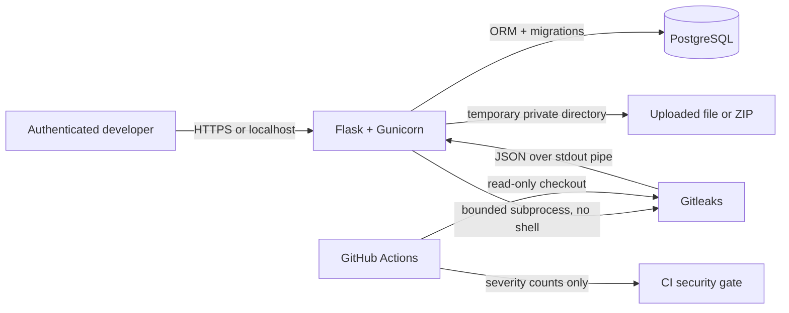

# SecretShield Pro

**SecretShield Pro — Cloud Credential Protection Platform** helps developers find likely credentials in code before they reach a public repository, then keep a redacted record of what was found.

## The real problem

Developers sometimes commit API keys, passwords, private keys, or cloud tokens by mistake. If a credential is exposed, deleting the line alone may not be enough: it may still exist in Git history, and the credential may need to be revoked or rotated with its provider. SecretShield demonstrates a practical prevention loop: **scan → review redacted metadata → block risky changes in CI → rotate/remove → rescan**.

The project is a college-scale security tool. It detects patterns; it does not prove a credential is valid or automatically revoke credentials.

## What is implemented now

- Authenticated Flask dashboard with password hashing, session protection, login rate limiting, CSRF protection, and security response headers.
- Real Gitleaks scans of an individual source/config file or a ZIP archive; optionally scans Git history when the ZIP includes a local `.git` directory.
- A rule-specific `AWS_SECRET_ACCESS_KEY` assignment check reports credential-shaped values in that named variable even when the value contains placeholder words such as `fake` or `test`; Gitleaks' generic placeholder suppression remains active for other variables. The AWS access-key-ID suffix `EXAMPLE` remains intentionally allowlisted upstream. Findings are pattern matches, not credential validation.
- ZIP controls for file-count and decompressed-size limits, suspicious compression, path traversal, symlinks, and file types. Uploaded code is never executed.
- PostgreSQL storage through SQLAlchemy and Flask-Migrate; local tests can use SQLite.
- Secret values and matching lines are not returned, logged, or persisted. The Gitleaks JSON report is read through a process pipe in memory; uploaded source is scanned in a private temporary directory that is deleted after the request.
- Findings store a keyed fingerprint and redacted metadata: rule, severity, source path, line, status, and detection time.
- Cross-scan verification resolves a finding only when a later successful scan of the same named source no longer contains its fingerprint.
- Incident workflow with guarded status transitions, remediation notes, event timeline, and an audit trail for scans and triage actions.
- User-scoped scan/findings APIs and redacted CSV export.
- A configurable GitHub Actions gate scans Git history and blocks at a selected severity. The pipeline prints counts only; it doesn’t upload a raw scanner report.
- A fabricated-secret ZIP generator for demonstrations.

## Architecture



The browser never receives raw Gitleaks output. Docker Compose runs the web app as a non-root user and keeps PostgreSQL private on the Compose network. The web port binds to `127.0.0.1` by default.

See [docs/architecture.md](docs/architecture.md) and [docs/security-model.md](docs/security-model.md).

## Run with Docker Compose

Requirements: Docker Desktop/Engine with Compose v2 and Git. From the project directory in PowerShell:

```powershell
Copy-Item .env.example .env
```

Edit `.env` and set both `SECRET_KEY` and `POSTGRES_PASSWORD` to unique values. Generate a signing key if desired:

```powershell
py -c "import secrets; print(secrets.token_urlsafe(48))"
```

Paste the generated value into `SECRET_KEY`. Set `POSTGRES_PASSWORD` to a unique password containing only letters and numbers (for example, generate one with `py -c "import secrets; print(secrets.token_hex(24))"`). Compose uses this same value for both PostgreSQL initialization and the app's database connection, so do not add a separate `DATABASE_URL` to `.env`.

Start the app and database, applying the included migration automatically:

```powershell
docker compose up --build -d
docker compose ps
docker compose logs -f web
```

Create the first administrator interactively; no default account or password is shipped:

```powershell
docker compose exec web flask --app secretshield:create_app create-admin
```

Open [http://localhost:5000](http://localhost:5000) and sign in with the account you just created. Stop with `docker compose down`; database data remains in its named volume. Remove demo data permanently with `docker compose down -v`.

## Deploy a teacher demo on Render

The repository includes a `render.yaml` Blueprint for a Docker web service and PostgreSQL database in Singapore. In Render, create a new Blueprint from `tarang54-tech/SecretShield`, review the two resources, and set the prompted `ADMIN_USERNAME` plus a unique `ADMIN_PASSWORD` of at least 12 characters. Render generates `SECRET_KEY`; no credentials belong in GitHub. After the first successful deploy, remove `ADMIN_PASSWORD` from the service environment and redeploy; the initial admin remains in PostgreSQL.

This uses Render's free plans for a short demo. Free web services sleep after 15 minutes of inactivity, so the first visit may take about a minute. Free PostgreSQL expires after 30 days and the free service has no shell access. Treat this as a demo only, use fabricated scan files, and do not upload real credentials or sensitive source code.

## Local development and tests

Python 3.11+ is required. For local runs, install requirements, set a development `SECRET_KEY`, use SQLite, and install Gitleaks on PATH:

```powershell
py -m venv .venv
.\.venv\Scripts\Activate.ps1
py -m pip install -r requirements.txt
$env:SECRET_KEY = (py -c "import secrets; print(secrets.token_urlsafe(48))")
$env:DATABASE_URL = "sqlite:///secretshield-local.db"
flask --app secretshield:create_app db upgrade
flask --app secretshield:create_app create-admin
flask --app secretshield:create_app run
```

Run tests inside the virtual environment:

```powershell
py -m pytest -q
```

Tests mock Gitleaks; they never use genuine credentials. The real scan engine is packaged in the Docker image. In this workspace, Docker and the Gitleaks binary were not available, so Compose startup and an actual Gitleaks scan have not yet been verified here.

## Demonstration walkthrough

1. Log in and scan a clean `.py` file or ZIP.
2. Generate a temporary fabricated-token ZIP: `py scripts/make_demo_bundle.py`. Upload the printed ZIP path in the dashboard.
3. The app reports a custom `secretshield-demo-key` finding, severity, file, and line. Its raw token should not appear in the dashboard, API response, database finding row, CSV, or logs.
4. Review the finding. **Acknowledge** means someone reviewed it; it does not mean it is fixed.
5. Generate a clean comparison ZIP with `py scripts/make_demo_bundle.py --clean` and scan it.
6. Push a branch/PR containing a fabricated high-severity match to demonstrate that GitHub Actions blocks it. Remove the match and rerun the workflow to show a pass.
7. Delete the temporary demo ZIP after the exercise.

The sample fixture uses an explicitly fabricated custom token format; it cannot authenticate to a cloud provider.

## API

All app APIs require login. State-changing requests require a valid CSRF token.

| Endpoint | Purpose |
| --- | --- |
| `GET /healthz` | Container health check |
| `GET /api/scans` | List the current user’s recent scans |
| `POST /api/scans` | Scan one multipart file or ZIP (`file`, optional `git_history=true`) |
| `GET /api/findings` | List/filter redacted findings by `severity` and `status` |
| `POST /api/findings/<id>/acknowledge` | Mark a finding reviewed; does not resolve it |
| `POST /api/findings/<id>/verify` | Verify resolution with `{"scan_id": <later clean scan id>}` |
| `GET /api/reports/findings.csv` | Download the current user’s redacted finding report |
| `GET, POST /api/incidents` | List incidents or create one with an optional related finding |
| `PATCH /api/incidents/<id>` | Update incident status and remediation notes |
| `GET /api/incidents/<id>/events` | Read incident timeline |
| `GET /api/audit` | Read the current user’s recent audit events |
| `GET /scans/<id>` | Read a user-owned scan and its redacted findings |

## CI policy

`.github/workflows/secret-scan.yml` scans the checked-out Git history using the pinned Gitleaks container. It defaults to blocking `high` and `critical`; lower-severity detections are counted in the job summary. Set a repository Actions variable named `BLOCK_AT_SEVERITY` to `critical`, `high`, `medium`, or `low` to change the policy. The JSON report travels through a pipe into the policy script; it is not uploaded as an artifact.

## Security boundaries and limitations

- Never upload real credentials unless you are authorized and understand that the app host processes the source. The source file exists briefly in a restricted temporary directory; the app deletes it after the scan.
- The dashboard is a local educational deployment, not a multi-tenant production service. It lacks user registration, MFA, SSO, external object storage, and a distributed rate-limit backend.
- Acknowledgement records human review; only a later clean scan of the same named source can verify a finding as resolved. Incident resolution requires remediation notes and a verified related finding.
- Local repository path scanning and remote GitHub repository integration are not included. Git history is supported through an explicitly supplied local repository ZIP with its `.git` directory.
- AWS IAM inspection is not included in this first implementation. The app starts without AWS credentials and does not accept cloud keys in its UI.
- A finding is a pattern match, not proof a credential is valid. Revoke/rotate suspected exposed credentials with the owning provider and investigate use.
- Keep Docker and the host OS updated. Do not expose PostgreSQL or the Docker socket; this project does not mount the Docker socket.

## Next implementation stages

1. Optional, read-only AWS IAM metadata integration using the AWS credential provider chain.
2. Local directory and Git repository scanning plus deeper scanner/GitHub Actions integration.
3. Production hardening such as MFA, external identity, distributed rate limiting, and durable audit retention.

## Viva summary

- **Secret scanning** checks source content and Git patches for patterns resembling credentials.
- **Gitleaks** provides the detection rules; SecretShield adds authenticated workflow, safe upload handling, redacted records, and policy decisions.
- **CI/CD gate** runs before merge and returns a failing status when policy severity is met.
- **Least privilege** means the scanner only reads uploaded local source; any future AWS integration must use read-only IAM.
- **Rotation** invalidates an exposed credential and replaces it with a new one stored outside source code.
- **False positives** are possible; a human reviews metadata without viewing a secret value in this platform.

For AWS deployment notes, see [docs/aws-deployment.md](docs/aws-deployment.md). AWS is an optional future integration, not required for local operation.
