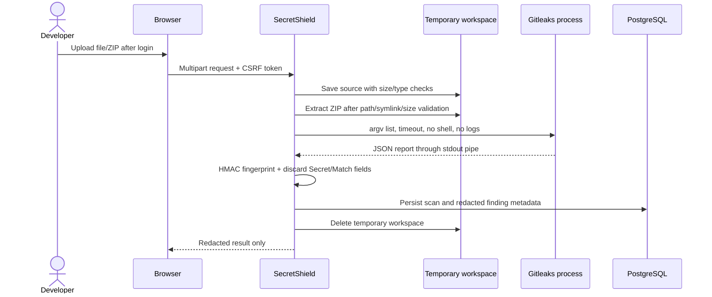

# Architecture

## Components

- **Flask/Gunicorn web app:** authenticated browser/API layer, bounded scan orchestration, and request validation.
- **Gitleaks:** pinned scanner process invoked with an argument list and no shell. Stdout carries the JSON report to the parent process; stderr is suppressed to prevent secret-bearing logs.
- **PostgreSQL:** stores accounts, scan metadata, and redacted finding metadata. Migrations are managed by Flask-Migrate/Alembic.
- **Temporary scan workspace:** private, per-request directory for the uploaded file and extracted ZIP content; removed when the request finishes.
- **GitHub Actions gate:** read-only checkout, local Gitleaks container, and a policy script that emits severity counts and a pass/fail status.

## Data flow and trust boundaries

The upload is untrusted input. The scanner is a child process with a time limit. ZIP extraction validates every member before writing and enforces actual decompressed byte limits while streaming. No uploaded program is run. The database contains no raw secret or full matching line. The dashboard only binds to loopback in Compose; PostgreSQL has no published port.

## Current scope

The first application slice supports one uploaded source file or one ZIP. Git history is available when a ZIP includes a valid `.git` directory and the user selects the history option. Remote repository URLs and arbitrary local filesystem paths are not accepted.
